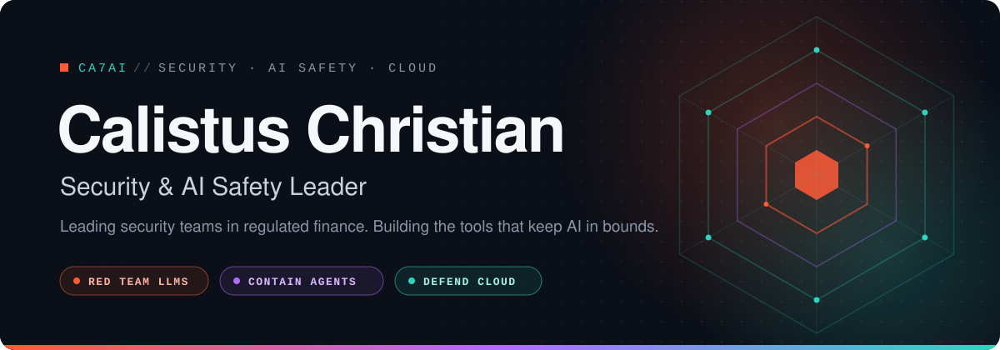

<!--
GitHub Profile for Calistus Christian (@ca7ai)
Executive narrative for Sr Manager positioning
Last updated: 2026-11-09
-->

<div align="center">

<picture>
  <source media="(prefers-color-scheme: dark)" srcset="./assets/hero-dark.svg">
  <source media="(prefers-color-scheme: light)" srcset="./assets/hero-light.svg">
  
</picture>

<br><br>

[](https://linkedin.com/in/calistuschristian)
[](https://n8n.io/creators/ca7ai/)
[](https://github.com/ca7ai)

</div>

<br>

I lead security teams in high-stakes environments, with a focus on **cloud security** and **AI governance**. I protect critical systems while keeping the business moving fast.

I build Red and teaming engines, LLM honeypots, agent sandboxes, and threat intel pipelines which all live here, shared openly so the rest of the industry can defend better.

```yaml
focus:      [agentic containment, LLM red teaming, AI governance]
leadership: [team scaling, incident response, security strategy]
stack:      [AWS, Bedrock, Python, Go, Docker, Lambda, n8n]
```


## Featured Work

<table>
<tr>
<td colspan="2" valign="top">

<sub><code>01 · AGENTIC CONTAINMENT</code></sub>

### [glasswall-sandbox](https://github.com/ca7ai/glasswall-sandbox)

Local-first execution sandbox for AI agents. Wraps untrusted agent actions in macOS `sandbox-exec` profiles and Docker containment, with token-optimized SQLite audit trails.


</td>
</tr>
<tr>
<td width="50%" valign="top">

<sub><code>02 · AI RED TEAMING</code></sub>

### [LLM-Vulnerability-Scanner](https://github.com/ca7ai/LLM-Vulnerability-Scanner)

Serverless red teaming engine for AWS Bedrock. Scans Llama 3, Claude 3, and custom models for exploitable weaknesses.


</td>
<td width="50%" valign="top">

<sub><code>02 · AI RED TEAMING</code></sub>

### [RedTeam-Agent](https://github.com/ca7ai/RedTeam-Agent)

Autonomous multi-model red teaming. Attacker agents probe victim LLMs to surface failures before adversaries do.


</td>
</tr>
<tr>
<td width="50%" valign="top">

<sub><code>03 · THREAT INTELLIGENCE</code></sub>

### [Mirage-HoneyPot](https://github.com/ca7ai/Mirage-HoneyPot)

LLM-specific honeypot that exploits token limits. Dual Trap and Radar components lure and fingerprint attackers.


</td>
<td width="50%" valign="top">

<sub><code>03 · THREAT INTELLIGENCE</code></sub>

### [Mirage-Sight](https://github.com/ca7ai/Mirage-Sight)

Automated threat intel for the Mirage ecosystem. S3 ingestion feeding daily and monthly intelligence reports.


</td>
</tr>
<tr>
<td width="50%" valign="top">

<sub><code>04 · SECURITY TOOLING</code></sub>

### [pp-virustotal](https://github.com/ca7ai/pp-virustotal)

VirusTotal CLI built for fast, scriptable threat analysis workflows.


</td>
<td width="50%" valign="top">

<sub><code>04 · SECURITY TOOLING</code></sub>

### [pp-shodan](https://github.com/ca7ai/pp-shodan)

Shodan CLI for discovering and monitoring exposed assets.


</td>
</tr>
</table>


## What I Bring

<table>
<tr>
<td width="25%" valign="top">

**☁️ Cloud Security**

<sub>AWS and multi-cloud<br>Infrastructure compliance<br>Serverless architectures</sub>

</td>
<td width="25%" valign="top">

**🛡️ AI / LLM Security**

<sub>Model red teaming<br>Prompt injection defense<br>AI governance frameworks</sub>

</td>
<td width="25%" valign="top">

**⚙️ Automation**

<sub>Python security tooling<br>Lambda and Step Functions<br>n8n orchestration</sub>

</td>
<td width="25%" valign="top">

**👥 Leadership**

<sub>Team scaling and talent<br>Incident response<br>Security strategy and risk</sub>

</td>
</tr>
</table>

<br>

<div align="center">
<sub><code>Red team the models. Contain the agents. Defend the cloud.</code></sub>
</div>
